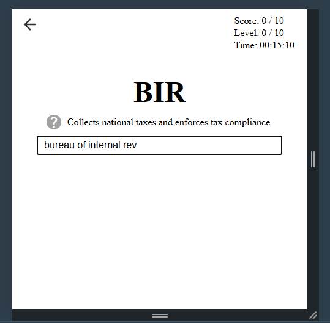

# AcronymPH 🇵🇭

> An interactive web-based quiz application to challenge yourselves by typing out the official names of 77 common Philippine Government agencies with the help of acronyms and brief description. 

You can view it live [here](https://isaacnicomedez.github.io/gov-acronym-ph/)

## Features

* **3 Difficulty Levels:** Match your expertise from easy-intermediate-hard.
* **Timed Gameplay:** Mastered all agencies? type faster and track how fast you can complete each set.
* **High Score Persistent Storage:** Track your progress locally using `localStorage`.

## Technologies Used

HTML, CSS, JS

## Credits
* Banner artwork: **"Chill Nights Remaster"** by [@NyaMocchi](https://ko-fi.com/nyamocchiartofficial)
